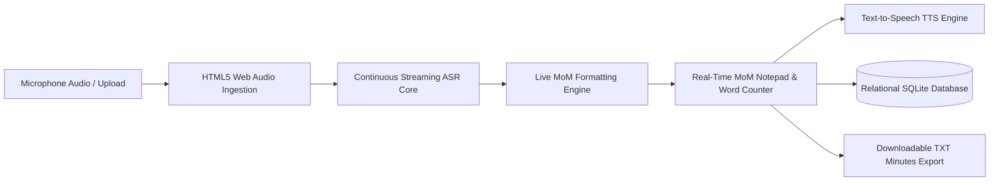

# 🎙️ MeetBrief - Live Meeting Platform with Real-Time ASR & MoM

[](https://www.python.org/)
[](https://flask.palletsprojects.com/)
[](https://github.com/SYSTRAN/faster-whisper)
[](https://www.sqlite.org/)
[](MeetBrief_Project_Explanation.mp4)
[](tests/)

**MeetBrief** is a lightweight, privacy-first real-time meeting room platform that embeds an on-premise Automatic Speech Recognition (ASR) tool directly inside the meeting space. It captures spoken dialogue in real time, formats it clearly as **Minutes of the Meeting (MoM)** with live timestamps, provides built-in **Text-to-Speech (TTS)** to read all notes aloud, and saves records directly to a local SQLite database with plain text (`.txt`) export.

No complex cloud AI dependencies, API keys, or clumsy multi-page navigation—just the ASR tool working seamlessly inside a clean, modern meeting environment.

---

## 🌟 Key Features

1. **🎙️ Embedded Real-Time ASR**:
   - Continuous in-browser streaming speech-to-text without word limits or dropouts.
   - Intelligent watchdog auto-reconnects recognition within 150ms of silence, ensuring uninterrupted dictation past 60 words.
   - On-premise Faster-Whisper CPU fallback for uploaded recorded audio files (`.wav`, `.mp3`, `.m4a`).
   - Real-time audio waveform visualizer and active speaker indicator rings.

2. **📝 Formatted Minutes of the Meeting (MoM)**:
   - Formats conversational speech into clean, timestamped dialogue entries `[HH:MM:SS AM/PM]`.
   - Real-time dynamic word counter and agenda synchronization.
   - Editable notepad allowing manual adjustments or direct typing.

3. **🔊 Built-In Text-to-Speech (TTS)**:
   - 1-click **"Read Aloud MoM"** translating all written minutes back into natural spoken voice.
   - Individual read-aloud controls for each saved session card in the archives.

4. **💾 Instant Persistence & Export**:
   - Save complete meeting minutes to SQLite (`meetbrief.db`) with date, time, subject, and duration.
   - 1-click **"Export TXT"** download for offline distribution.
   - Interactive history archive to review, listen to, download, or delete past minutes.

---

## 📐 System Architecture



---

## 📂 Project Structure

```
asr-tool-implementation/
├── app.py                             # Flask web server & REST endpoints
├── database/
│   ├── __init__.py
│   └── db.py                          # SQLite schema definitions & CRUD queries
├── engine/
│   ├── __init__.py
│   └── speech_recognizer.py           # On-premise Faster-Whisper ASR engine
├── templates/
│   └── index.html                     # Single-page meeting room platform UI
├── static/
│   ├── css/
│   │   └── style.css                  # Modern dark-mode meeting room styling
│   └── js/
│       └── app.js                     # Continuous ASR, TTS, visualizer & MoM sync
├── tests/
│   ├── test_meetbrief_platform.py     # Automated route & database tests
│   └── test_meetbrief.py              # Engine unit tests
├── MeetBrief_Project_Explanation.mp4  # Official Full HD video explanation (1080p)
├── generate_video_explanation.py      # Video generation script
├── requirements.txt                   # Project dependencies
├── LICENSE                            # MIT License
└── README.md                          # Project documentation
```

---

## 🚀 Quickstart Guide

### 1. Clone the Repository
```bash
git clone https://github.com/hariraman-24/asr-tool-implementation.git
cd asr-tool-implementation
```

### 2. Install Dependencies
```bash
pip install -r requirements.txt
```

### 3. Run the Platform
```bash
python app.py
```

### 4. Open in Browser
Visit **[http://127.0.0.1:5000](http://127.0.0.1:5000)** in Google Chrome or Microsoft Edge.

---

## 💡 How to Use

1. **Set Agenda**: Enter your meeting topic or subject in the top bar.
2. **Unmute Mic**: Click **"Unmute Mic"** to begin speaking. Spoken words will appear immediately with timestamps in the right-hand **Minutes of the Meeting (MoM)** notepad.
3. **Read Aloud**: Click **"Read Aloud MoM"** to hear the browser read your meeting minutes back to you via Text-to-Speech.
4. **Save MoM**: Click **"Save MoM"** to store the complete minutes into the local database archive.
5. **Export**: Click **"Export TXT"** to download a formatted `.txt` report of your minutes.

---

## 📡 REST API Reference

| Endpoint | Method | Description |
| :--- | :---: | :--- |
| `/` | `GET` | Serves the main live meeting platform interface |
| `/api/save-mom` | `POST` | Saves meeting title, MoM text, and duration to SQLite |
| `/api/meetings` | `GET` | Returns list of all saved meeting sessions (JSON) |
| `/api/meeting/<id>` | `DELETE` | Deletes a meeting record by ID |
| `/api/meeting/<id>/download` | `GET` | Streams formatted plain text (`.txt`) file download |
| `/api/transcribe-audio` | `POST` | Transcribes uploaded recorded audio file via Faster-Whisper |

---

## 🧪 Running Automated Tests

Run the complete test suite using `pytest`:
```bash
pytest tests/test_meetbrief_platform.py -v
```

---

## 🎥 Video Explanation

The repository includes a Full HD explanation video:
* **File**: [`MeetBrief_Project_Explanation.mp4`](MeetBrief_Project_Explanation.mp4)
* **Format**: 1920×1080 (30 FPS), H.264 Video + AAC Audio
* **Duration**: 3 minutes 00 seconds
* **Compatibility**: Playable in VLC, Windows Media Player, QuickTime, and Google Drive.
